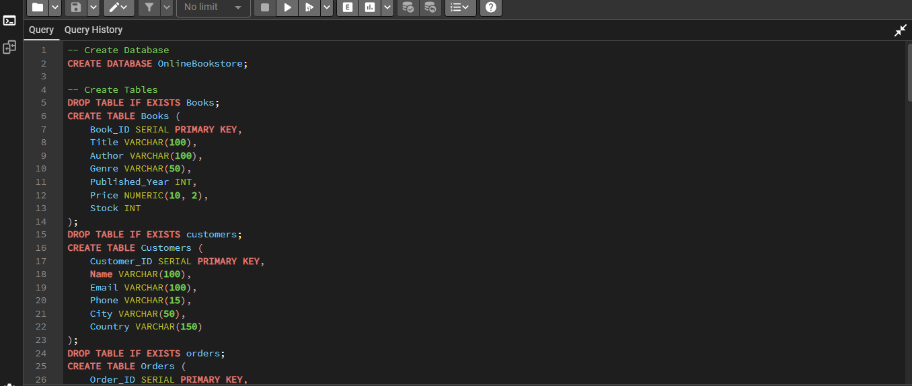
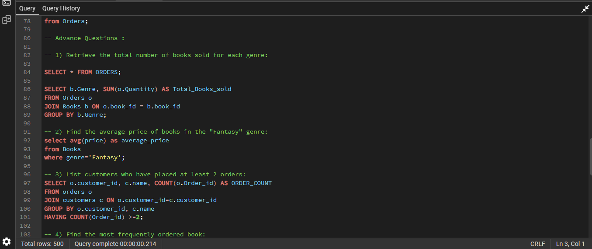
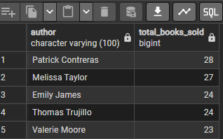

Online Bookstore Database Management System

Project overview:

This project uses PostgreSQL to create and query a relational database for an online bookstore. It contains three related tables: Books, Customers, and Orders.
Tools:
- PostgreSQL
- pgAdmin 4
- SQL

Database structure:
- Books: book title, author, genre, publication year, price, and stock.
- Customers: customer name, email, phone, city, and country.
- Orders: customer, book, order date, quantity, and total amount.
Orders.Customer_ID references Customers.Customer_ID, and Orders.Book_ID references Books.Book_ID.

SQL concepts demonstrated:
- Database and table creation
- SERIAL primary keys and foreign keys
- Filtering with WHERE and BETWEEN
- Sorting with ORDER BY and limiting results with LIMIT
- Removing duplicate values with DISTINCT
- Aggregate functions: SUM, AVG, and COUNT
- Grouping with GROUP BY and filtering groups with HAVING
- Inner and left joins
- Handling missing values with COALESCE

Questions explored:
The queries investigate book genres and publication years, customers by country, orders in a date range, total stock, book prices, order quantities and amounts, revenue, sales by genre and author, repeat customers, popular books, and estimated remaining stock after orders.

Project learning:

This project provided practice in designing a relational database and writing SQL queries to answer operational and business questions about books, customers, orders, sales, and inventory.

📸 Project Screenshots

 1. Database Schema and SQL Editor

This screenshot demonstrates database creation, table structures, primary keys, and SQL implementation.

[View full Database Schema screenshot](./online_bookstoreSQL.png)

2. Advanced SQL Queries

This screenshot demonstrates advanced SQL operations, including JOIN, GROUP BY, aggregate functions, and HAVING clauses.

[View full Advanced SQL screenshot](./online_bookstoreSQL1.png)

 
Question 6: Total Books Sold by Each Author

Objective: Calculate the total number of books sold by each author and identify the authors with the highest book sales.

SQL Concepts Used:
- INNER JOIN
- SUM() / COUNT() (as applicable to the query)
- GROUP BY
- ORDER BY

SQL Query Result:

The following table displays the total books sold by each author.

Data Visualization – Books Sold by Author:

The pie chart provides a visual comparison of book sales across the five authors.

Key Findings:
- Patrick Contreras: 28 books
- Melissa Taylor: 27 books
- Emily James: 24 books
- Thomas Trujillo: 24 books
- Valerie Moore: 23 books

Patrick Contreras has the highest number of books sold among the five authors.

